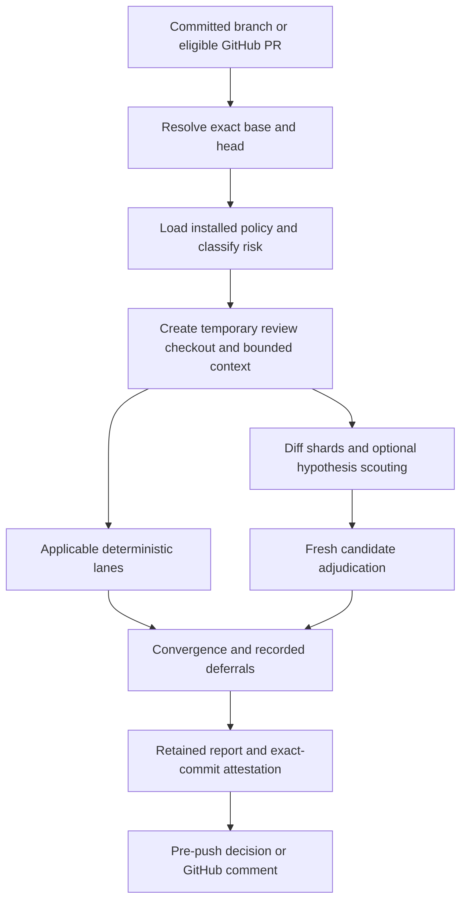

# How Rove Sentinel works

Sentinel is a local Node.js orchestrator. Claude Code and Codex provide the
reviewer processes; Sentinel prepares context, validates structured output,
applies policy, and owns the final record. It does not embed an LLM or copy
provider code into the package.

## The review unit

Identity includes normalized repository, merge base, head SHA, engine version,
charter version, and installed policy digest. A result for an earlier commit,
different base, different policy, or different repository cannot substitute for
the requested review. The reviewed code is a detached Git worktree. Working-tree
edits are not silently included.

The context contains a bounded textual diff, file manifest, risk reasons,
installed charter and relevant lessons, commit history, reference map, and
matching open bug briefs when that project convention exists. It is not a
persistent semantic index. Reference discovery is heuristic: it extracts
declarations from JavaScript/TypeScript, Svelte, Rust, Go, Python, Ruby, PHP,
Java, Kotlin, Scala, C#, Swift and C/C++ files with a line lexer, not a
parser, and sweeps each declared name with `git grep` over the head tree. The
map reads Git objects only, so it is built from the repository while the
review checkout is created; its Git processes run with bounded parallelism.
Excluded files remain visible in the manifest; excluded binary contents are
not reviewed as text.

The context also quotes the messages of the commits between base and head,
newest first and bounded to 4 KB, as the change's stated intent. They are
untrusted evidence; an incomplete claimed fix is reviewed as a defect the
change introduces. A PR description does not reach the review.

## Review and verification stages

Low-risk work uses bounded shards. Medium and high risk add a scout and focused
hypothesis reviews. A high-risk round has 8 shards up to about 830 KB of
patch; a larger change gets one more shard per 104 KB, up to the project's
`maxShards` (16 by default), so each reviewer covers about the same amount of
code. A shard holds whole files, so one very large file's changes stay in one
shard, read in parts. Reviewers run 8 at a time, so 16 shards take a second wave. Past the cap
shards grow again, and the report says they were reviewed more thinly. Shards cover the included hunks; they do not guarantee that
a model understood or detected every defect. A changed test shares a shard with
the changed file of the same name it tests (`a.test.ts`, `test_a.py`,
`a_test.go`, `ATest.java`) when the shard bounds allow, and that reviewer
applies the lens of each kind of file its shard holds. A changed file without a textual
hunk (binary content, a rename or copy without a content change, a mode change,
an empty file) owns no shard, because there is nothing in it to read; the
`changed-files.md` lookup lists it with its reason and old path so reviewers can
still check references to it, and the report records it. A shard larger than one read (24 KB) is
written in parts that the reviewer reads whole, one call each, because a
provider may elide the middle of a larger tool output; its time limit grows
with its size (5 minutes for one part, a minute per further 12 KB, at most 12).
The prompt forbids reading two parts in one command, and the engine does not
rely on that: when the reviewer of a shard of several parts reports its review
incomplete, the shard's one retry gives each part to a reviewer of its own,
and the shard counts only if every part completes. A part reviewer sees its
part, not the rest of the shard. A line longer than a part is cut across
parts. Patch context is up to 80 lines either side of a change but at most
4 KB (never fewer than 3 lines), so a file of very long lines gets fewer
context lines; only context is dropped, and the patch still applies.
Every reviewer reads a small context that separates required reads (the
charter, the selected lessons and the open briefs, each in parts that fit one
read) from lookups it searches (the reference map, the changed-file lists with
a patch index of each file's line range, the Git history, the full patch). The
scout owns no part of the patch: it reads a small patch whole and otherwise
picks files through the index. A review is incomplete when a required read was
blocked, failed or came back truncated (the assigned diff, a required context
read, or in a follow-up round the code that settles an assigned prior blocker,
read around its location, by line range in a large file), or when no tool
host was available; a spent verification budget is not incompleteness, and the
error keeps the reviewer's own account.

The context and its required reads travel in the prompt itself when together
they fit 96 KB, and so do a shard's hunks and an adjudication batch's
candidates when each fits 128 KB: the reviewer starts reasoning instead of
spending its first turns on reads, and no tool output can come back with its
middle elided. The material sits between markers that carry a per-review
nonce, with the block every reviewer shares first. Prompts reach both CLIs on
standard input, so no command-line limit applies. Larger material is read
from files in parts, as described above; inlined material counts as read.

Candidate findings are independently
adjudicated in fresh contexts and validated against a structured schema.
Adjudication starts while reviewers still run: each review's candidates join
a stream as it settles, with the same floor and identity merge, and a bound of
50 candidates (four per shard in a round of more than 12 shards, and room for
every inherited blocker, at most 200). A batch of five goes to a fresh adjudicator at once, and what remains
when the last reviewer settles goes in batches of at most three. A candidate
already sent is not replaced by a later duplicate of higher confidence. A
round that will fail closed stops sending and waits for the batches already
running.
A candidate under the confidence floor (50) is not adjudicated; the report
keeps up to 40 of them, highest confidence first, as evidence for recall
analysis only, and the `ledger` command marks an external finding in a file
that holds one as `below-floor` rather than unseen.

Author-family routing normally puts the other provider in the lead. Human
changes use risk-based routing. The inherited `grok/` author label prefers
Claude; there is no Grok provider. A single authenticated provider preserves role
counts and fresh contexts while the report records reduced model diversity.
Installed model/effort settings and bounded escalation are described in [models](models.md).

Deterministic lanes run beside the model review, with no model call, and
report hits on added lines: markdownlint on changed Markdown; shellcheck on
shell scripts (by extension or shebang); actionlint on GitHub workflows;
gitleaks on changed text files, scanned as a copy with its built-in rules
(including their own path exclusions, such as lock files and images) and with
`gitleaks:allow` comments ignored, so nothing in the branch can switch it off;
secrets are redacted; and ruff on Python. A lane analyzes at most 200 files
(gitleaks 1,000, each at most 1 MiB and 32 MiB in all, never a symlink or a
binary file), and its note says how many it left out. Those four analyze text, never execute repository code, and
run whenever the tool is installed; a tool is found on PATH, never in the
reviewed checkout. Project commands listed in installed
policy (`lintCommands`, for example `tsc` or `eslint`) and the opt-in Clippy
lane execute the project's toolchain and configuration from the reviewed head,
so only trusted policy enables them. A missing tool, a timeout or a failure is
a lane note; a partial deterministic run is not a clean bill of health. A hit
is a deterministic finding: an error-level hit (a shellcheck error, a workflow
error, a probable secret outside test paths, a Python syntax error or undefined
name, a project command's error) is P2 and blocks; a warning is P3 and needs a
fix or a recorded deferral. A process tree that cannot be proven terminated fails closed.

## Repairs and decisions

Compatible reviewed ancestors permit incremental follow-up. Previous blockers
are rechecked: a reviewer omits one only when it verified the fix, reports one
it could not settle again (it reaches adjudication whatever confidence or
priority the reviewer gave it), and a blocker no reviewer could be assigned is
carried forward as still present. Omission is read as a verified fix; that
rests on the reviewer's instruction, not on a mechanical check. New verified P0/P1 always block. P2 enforcement distinguishes
the latest repair, persistent blockers, and late discoveries outside the repair.
The current limits are six repair rounds and two late-discovery blocking rounds.
Budget exhaustion never silently erases a finding: eligible advisories require
an explicit recorded deferral before the hook accepts them. Deferrals are tied
to finding identity and lineage; P0/P1 are not deferrable.

## Operations and bounds

One watcher serializes reviews for a repository, while a review can use up to
eight provider subprocesses at once. Medium/high rounds start from four/eight
shards and a large change gets more (see above). The text patch limit is
8 MiB; the hook waits 120 minutes, and longer while the watcher is reviewing
that very request, at most 12 hours. An ordinary push may
carry at most sixteen candidate refs and at most one that still needs review.
The default retention is thirty days, capped at eighty attestations and fifty
reports; audit events have separate bounds. See `constants.mjs` for all limits.

A round that fails closed after some shard reviewers completed keeps their
reviews for 24 hours under the same identity as an attestation, each under a
digest of what that reviewer was assigned. A rerun of that exact identity
reviews only the other shards, adjudicates every candidate afresh, and records
which shards it reused; `--force` and a round that ends in a report keep
nothing. A kept review is not a decision: only a completed round attests.

State identity is shared by local clones of the same remote. To preserve the
Rove migration and prevent duplicate watchers, this release retains the legacy
`Rove/shared-review-gate` Windows state namespace and `Rove-Shared-Review-Gate`
task prefix. Engine and policy version checks prevent stale evidence reuse.
On macOS and Linux corresponding inherited state paths remain implemented but
are not evidence of live platform qualification.

## Module map for contributors

| Modules | Responsibility |
| --- | --- |
| `cli`, `init`, `config`, `install` | Entry points, onboarding and trusted installation |
| `gate`, `risk`, `shards`, `convergence`, `dispositions` | Review planning and final decisions |
| `context`, `refmap`, `git` | Committed inputs, isolated checkout and bounded context |
| `providers`, `process`, `detach`, `cleanup` | CLI adapters and subprocess lifecycle |
| `lint`, `guiEvidence`, `evidenceSlug` | Deterministic and optional visual-evidence checks |
| `daemon`, `prepush`, `github` | Queue, push enforcement and eligible PR comments |
| `storage`, `ledger`, `constants` | Records, external-review comparison and protocol limits |
| `updates`, `automatic-updates`, `engine-store` | Release discovery, immutable shared runtimes and per-repository activation |
| `launcher`, `maintenance`, `update-notifications` | Runtime selection, review/update exclusion and visible update state |

Code lives under `scripts/review-gate/` to preserve extraction history and
regression coverage. This directory name is internal; users invoke
`rove-sentinel`.
